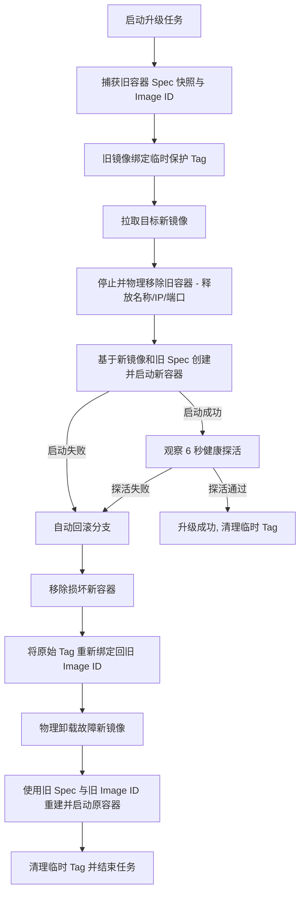
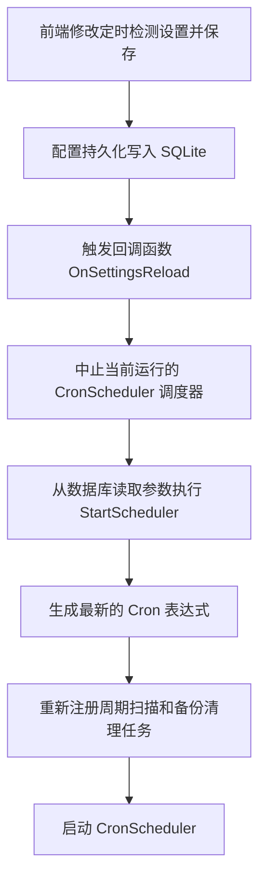

# 飞牛 FNOS Docker 容器升级管理器技术规格书 (Agent 面向)

## 1. 技术栈与部署约束
* **后端技术**: Go (无 CGO) + Gin + GORM + glebarez/sqlite。
* **启动与监听模式**:
  - **飞牛模式**（携带 `--fnos` 参数启动）：
    - 核心依赖：必须存在环境变量 `TRIM_APPDEST`。若缺失，程序直接终止退出。
    - 执行动作：监听 `${TRIM_APPDEST}/web.sock`。设置套接字文件读写权限为 `0666`。启动时自动清理历史残留套接字文件。
    - 数据/日志目录：优先使用环境变量 `TRIM_PKGVAR`。若缺失，则默认为 `./data`。
  - **原生模式**（无启动参数，默认）：
    - 核心依赖：不依赖飞牛环境变量。
    - 执行动作：在原生 TCP 端口上启动。优先读取 `PORT` 环境变量，若缺失则默认监听端口 `:2293`。
    - 数据/日志目录：强制设置为可执行文件同级目录。程序会在启动时将环境变量 `TRIM_PKGVAR` 设置为该同级目录，以确保数据库及日志文件等数据都保存在该目录下。
* **路由根路径**: 所有请求及静态资源统一路由在 `/app/docker-updater/` 路径下。不匹配此路径的请求直接返回 HTTP 404。
* **日志系统**:
  - 全局日志文件: `${TRIM_PKGVAR}/info.log`（最大单文件限制 3MB，达到上限后自动重命名为 `info_YYYYMMDD_HHMMSS.log` 格式，并自动创建全新 `info.log`。历史 `info_时间.log` 备份自动保持最多保留 3 份，过期自动清理）。
  - 任务日志文件: `${TRIM_PKGVAR}/logs/${container_name}.log`（动态按需创建）。
  - 日志前缀: 严格限制全系统仅使用 `[INFO]`、`[WARN]`、`[ERROR]` 三种标准日志前缀。禁止包含任何 emoji 表情或任何非标 Level 标签。
  - 访问日志过滤: 高频 WebSocket `/api/ws` 及 `favicon.png`/`favicon.ico` 访问请求予以静默过滤，避免日志污染。

## 2. 数据库结构定义 (SQLite)

### db.Setting (系统配置表)
```go
type Setting struct {
    Key   string `gorm:"primaryKey"`
    Value string
}
// 键映射:
// - auto_update_enabled: 是否开启定时自动升级 ("true"/"false")
// - auto_update_whitelist: 自动升级白名单容器名称列表 (JSON 数组，如 ["ddns-go"])
// - dockerhub_mirrors: DockerHub 镜像加速源列表 (JSON 数组，如 ["https://mirror.com"])
// - ghcr_mirrors: GHCR 镜像加速源列表 (JSON 数组)
// - check_type: 定时检测周期类型 ("hour"/"day"/"week"/"month", 默认 "day")
// - check_value: 定时检测周期数值 (整型，默认 1)
// - notify_enabled: 是否启用消息通知 ("true"/"false")
// - notify_type: 通知渠道类型 ("email"/"webhook", 默认 "email")
// - smtp_host, smtp_port, smtp_username, smtp_password (AES-256 加密), smtp_ssl, smtp_to
// - smtp_subject_template, smtp_body_template
// - smtp_subject_template_check, smtp_body_template_check
// - webhook_url, webhook_method, webhook_type ("custom"/"wechat"/"dingtalk"/"feishu")
// - webhook_template_*, webhook_template_check_*
// - last_check_time: 上次检测更新时间 (UTC ISO8601 格式)
// 注: InitDB 启动时会自动将历史键 smtp_enabled -> notify_enabled、temp_mirrors -> dockerhub_mirrors 一次性迁移并清理。
```

### db.AvailableUpdate (容器版本检测结果表)
```go
type AvailableUpdate struct {
    ContainerName  string `gorm:"primaryKey"`
    Image          string
    LocalDigest    string
    RemoteDigest   string
    LocalVersion   string // 提取的语义化版本号 (如 v1.2.0)
    RemoteVersion  string // 提取的远端语义化版本号 (如 v1.3.0)
    CheckedAt      string
    ComposeProject string
    CheckMethod    string
    HasUpdate      bool   // 是否存在可用更新；所有扫描到的容器均写入此表，通过该字段区分状态
}
```

### db.DeferredUpdate (延迟更新约束表)
```go
type DeferredUpdate struct {
    ContainerName string `gorm:"primaryKey"`
    Until         string // 截止日期 YYYY-MM-DD
}
```

### db.UpdateHistory (更新历史记录表)
```go
type UpdateHistory struct {
    ID            uint `gorm:"primaryKey;autoIncrement"`
    ContainerName string
    Image         string
    UpdatedAt     string
    Status        string // "success" 或 "error: [错误信息]"
}
```

### db.RegistryCredential (镜像仓库凭证表)
```go
type RegistryCredential struct {
    ID        uint   `gorm:"primaryKey;autoIncrement" json:"id"`
    Registry  string `gorm:"uniqueIndex" json:"registry"`
    Username  string `json:"username"`
    Password  string `json:"password"` // AES-256 加密密文
    UpdatedAt string `json:"updated_at"`
}
```

## 3. 升级检测机制规范
* **更新检测机制与触发场景**:
  - **被动元数据检查 (DistributionInspect)**:
    - 用于后台定时扫描（Cron）与服务启动初始化扫描。后台扫描禁止调用 ImagePull 拉取镜像，仅获取元数据。
    - 请求时带上与容器运行时一致的 `Platform` 平台架构（`os` / `architecture` / `variant`）。遇到多架构 Manifest List 时，解析匹配架构的 `Child Manifest Digest` 以及 `config.digest` (Image ID)。
    - **比对判定规则**: 只要远端 `Child Manifest Digest` 存在于本地 `RepoDigests` 中、远端 `config.digest` 等于本地镜像 `Image ID`、或本地 Docker `ImageInspectWithRaw` 能检索到此 Digest，即判定为无更新。
    - **远程语义化版本提取策略**: 被动元数据检查完成 Digest 比对后即直接返回，不主动发起专程拉取 Config 的额外网络请求；仅在降级至 ConfigDigest 检测且已成功获取 Config 时顺便解析。
  - **主动镜像拉取检查 (ImagePull + Inspect)**:
    - 仅在用户手动触发更新检测且镜像属于 `docker commit` / `docker load` 离线镜像（`RepoDigests` 为空）或元数据检查无法判定时调用。
    - 通过 SDK 的 `ImagePull` 更新 Tag 元数据，比对最新镜像 ID 与运行容器镜像 ID。ID 相同判定无更新，ID 变动判定有更新。
  - **401 认证多协议兼容**: 自动识别 `WWW-Authenticate` 标头类型，兼容 OCI Bearer Token 机制与 HTTP Basic Auth 挑战标头。
  - **Tag 列表多源加速轮询**: 远端 Tag 列表获取 (`GetRemoteTags`) 融入应用级 `dockerhub_mirrors` / `ghcr_mirrors` 镜像加速源节点轮询。

## 4. 加密与安全策略
* **对称加密**: 使用 AES-256-GCM 算法。
* **密钥文件**: 存放于 `${TRIM_PKGVAR}/secret.key`（文件权限 `0600`）。
* **解密异常控制**: Base64 解码失败、密文长度不足、校验失败均直接向上层传播并返回 error，彻底禁止明文自动降级兼容逻辑。

## 4. API 路由规范
所有路径均挂载于 `/app/docker-updater/api` 前缀下。

| 请求方法 | 路由路径 | 请求体 | 响应载荷 | 安全校验/约束条件 |
|---|---|---|---|---|
| GET | `/status` | 无 | `{"containers": [...], "last_check": "...", "history": [...], "active": {...}, "queued": [...]}` | 无 |
| POST | `/check` | 无 | `{"ok": true}` | 异步触发本地活动容器版本扫描比对并更新数据库 |
| GET | `/update/:name` | 无 | SSE 日志流 (分块传输) | 异步将容器升级任务注册至全局队列。SSE 从日志缓冲区推流 |
| POST | `/defer/:name` | `{"days": int}` | `{"ok": true, "until": "YYYY-MM-DD"}` | 写入延迟截止日期约束（`days: -1` 表示永久暂挂/无限期，对应返回 `"until": "forever"`） |
| POST | `/undefer/:name`| 无 | `{"ok": true}` | 移除延迟更新约束 |
| GET | `/container/:name/logs`| 无 | `{"logs": string}` | 从 Docker 引擎获取容器的末尾 200 行标准输出与标准错误日志 |
| GET | `/update-log/:name`| 无 | `{"found": bool, "logs": []string}` | `name` 参数必须符合正则 `^[a-zA-Z0-9][a-zA-Z0-9_.-]*$` 路径穿越过滤 |
| DELETE| `/update-log/:name`| 无 | `{"ok": true}` | `name` 参数必须符合正则 `^[a-zA-Z0-9][a-zA-Z0-9_.-]*$` 路径穿越过滤。删除任务日志 |
| GET | `/images` | 无 | `[{"id": string, "tags": []string, "size": int64, "created": int64, "containers": []string, "architecture": string, "version": string}]` | 获取本地已下载镜像列表 |
| DELETE| `/image` | 无 | `{"ok": true}` | Query 参数: `id` (镜像ID), `force` (是否强制删除)。校验运行状态与容器绑定关系 |
| POST | `/images/prune` | 无 | `{"ok": true, "space_reclaimed": uint64, "deleted_count": int}` | 物理清理满足 `dangling=true` 且 `until=24h` 的虚悬无用镜像 |
| GET | `/settings` | 无 | 系统配置 JSON | 动态对敏感 SMTP 凭据进行解密返回 |
| POST | `/settings` | 系统配置 JSON | `{"ok": true}` | 对敏感 SMTP 密码加密存储；对比保存前后配置差异并仅记录修改项增量日志，随后触发热重载定时任务调度器 |
| POST | `/settings/test-email`| 测试邮件配置 | `{"ok": true}` | 建立临时协议信道发送联通性测试邮件 |
| GET | `/settings/system-mirrors`| 无 | `[]string` | 只读解析宿主机 `/etc/docker/daemon.json` 中的 `registry-mirrors` |
| GET | `/tasks` | 无 | `{"queued": [], "active": {}}` | 获取排队队列的当前待执行及活动任务详情 |
| POST | `/tasks/cancel/:name`| 无 | `{"success": bool}` | 将尚处于 `waiting` 状态的升级任务移出队列 |
| GET | `/system/logs` | 无 | `{"logs": []string}` | 获取全局日志文件 `info.log` 的末尾 400 行记录 |
| DELETE| `/system/logs` | 无 | `{"ok": true}` | 以截断清空模式置空 `info.log` 物理大小 |
| DELETE| `/history` | 无 | `{"ok": true}` | 清空数据库所有更新历史，并遍历物理删除本地 logs 目录下的日志 |
| DELETE| `/history/:id` | 无 | `{"ok": true}` | 物理删除指定的历史记录 ID 及对应日志 |
| POST | `/container/:name/start`| 无 | `{"ok": true}` | 控制容器状态：启动，成功后触发全局 WebSocket 广播更新状态 |
| POST | `/container/:name/stop`| 无 | `{"ok": true}` | 控制容器状态：停止，成功后触发全局 WebSocket 广播更新状态 |
| POST | `/container/:name/restart`| 无 | `{"ok": true}` | 控制容器状态：重启，成功后触发全局 WebSocket 广播更新状态 |
| GET | `/registries` | 无 | 凭证列表 JSON | 密码字段已被强制屏蔽为 `******` 的仓库凭据展示 |
| POST | `/registries` | 凭证编辑负载 | `{"ok": true}` | 加密私有仓密码并存库，保存前将域名首尾多余协议前缀清除 |
| DELETE| `/registries/:id`| 无 | `{"ok": true}` | 删除对应的私有仓账户密码凭证 |
| GET | `/compose/projects` | 无 | `[{"name": string, "working_dir": string, "config_files": string, "containers": [...], "status": string, "services_count": int, "has_update": bool}]` | 按 com.docker.compose.project Label 归集并返回宿主机 Docker Compose 项目列表 |
| GET | `/compose/config` | `?project=name` | `{"project": string, "file_path": string, "content": string}` | 读取指定 Compose 项目的 docker-compose.yml 物理文件内容 |
| POST | `/compose/config` | `{"project": string, "content": string}` | `{"ok": true}` | 更新覆盖指定 Compose 项目的 docker-compose.yml 物理配置文件，校验仅允许 .yml / .yaml 路径 |
| POST | `/compose/lifecycle` | `{"project": string, "action": "start" \| "stop" \| "restart"}` | `{"ok": true}` | 批量下发 Compose 项目组内关联容器的生命周期控制指令 |
| GET | `/ws` | 无 | 协议升级载荷 | 升级为 WebSocket 长连接 |

## 5. 事件循环与排队机制
* **串行任务调度**: 任务处理器为单工循环。所有的升级任务和回滚任务排队推送至 `GlobalQueue` 执行。
* **白名单自动升级过滤**: 定时检测命中新版本且开启自动更新时，系统仅将处于 `auto_update_whitelist` 白名单集合内且未受暂挂约束的容器加入升级排队，白名单之外的容器自动跳过。
* **自动更新批次汇总通知**: 定时自动更新通过 `EnqueueAutoBatch` 以批次方式原子入队。批次内全部任务达到终态（成功/失败/取消）后汇总为 1 条通知统一推送（兼容邮件与 Webhook）；单容器保持单条明细，多容器输出统计摘要与逐容器结果；Webhook 推送自动执行全字段 JSON 转义与日志长度截断保护。
* **状态实时推送**: 任务队列修改、容器启停及更新流式日志均触发 WS 事件广播订阅的前端。
* **WebSocket 保活控制**:
  - `readPump`: 接收到 `{"type": "ping"}` 消息时，在写入 `c.send` 时必须使用 `select-default` 分支防范阻塞。协程头部采用 `defer recover()` 防止在 unregister 关闭 channel 时引起 `send on closed channel` 致命写 panic。
  - `writePump`: 每隔 30 秒向客户端通道推送 Ping 帧。
* **竞态防护**:
  - 嵌套锁规避: 统一日志的多路输出刷新函数中剥离锁操作，防范在 `RegisterExtraWriter` 独占锁时的重入死锁。
  - 运行排他锁: 容器启动/停止/重启 API 操作在下发 Docker 指令前，必须校验目标容器是否与当前 `GlobalQueue.active.ContainerName` 冲突，若冲突则予以拒绝。

## 6. 更新与自动回滚生命周期

* **纯 SDK 克隆重建**: 基于旧容器 `inspect` 捕获完整 Config、HostConfig 及 NetworkingConfig。停止并移除旧容器以自动释放名称、端口与网络资源。
* **旧镜像 Tag 保护**: 在 `ImagePull` 之前给旧 `Image ID` 绑定临时 Tag（`image_name:du_bak_<container>`），避免旧镜像沦为 `<none>` 悬空镜像。
* **6 秒健康探活与自愈回滚**: 新容器启动后轮询 6 秒探活；若异常，自动清除故障新容器、退标故障镜像，将原始 Tag 指回旧 `Image ID` 并基于内存 Spec 重建还原原服务。



## 7. 定时任务热重载工作流

